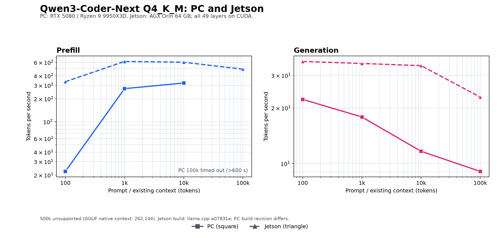

# Qwen3-Coder-Next Q4_K_M on the Jetson AGX Orin

## Measurements

| Context | PC prefill tok/s | Jetson prefill tok/s | PC generation tok/s | Jetson generation tok/s |
|---:|---:|---:|---:|---:|
| 100 | 22.33 | 334.72 | 2.44 | 35.68 |
| 1,000 | 271.33 | 615.87 | 8.31 | 34.81 |
| 10,000 | 321.48 | 601.76 | 4.01 | 33.87 |
| 100,000 | timeout (>600 s) | 487.98 | 9.06 | 22.88 |
| 500,000 | unsupported | unsupported | unsupported | unsupported |

Prefill is the rate for ingesting a synthetic prompt from an empty cache. Generation is the rate for producing 64 tokens after the KV cache has already been filled to the listed depth. The 100k prefill and generation rows each used one measured repetition; shorter Jetson tests used three repetitions, except generation at 1k and 10k, which used three repetitions in one grouped run.

## What this says about feasibility

**Yes, running this Q4_K_M model on this Jetson is feasible.** The Jetson is an AGX Orin Developer Kit with 64 GB unified memory. llama-bench identifies the GGUF as `qwen3next 80B.A3B`, with 79.67 billion total parameters and a 48.50 GB file. The CUDA run loaded all 49 of 49 layers. Its CUDA model buffer was 46,086.65 MiB, with a 166.92 MiB host model buffer.

At 100k context, the CUDA KV cache used 2,346 MiB, recurrent state used 75 MiB, and the compute buffer used about 411 MiB. The complete 100k prefill and decode tests succeeded. The machine had about 10 GiB available during the large-context run, so it fits but leaves limited headroom for other applications. The 262,144-token native context was not benchmarked; 500k is unsupported by the GGUF and was not attempted.

The measured decode rate was about 35 tokens/s at short contexts and 23 tokens/s at 100k context. That is the steady-state llama-bench decode rate, not model startup time or coding-task quality. Loading the 46 GB weights took substantial time during separate benchmark invocations. In normal use, load the model once and keep it resident.

## Comparison limits

The PC numbers are the supplied RTX 5080 / Ryzen 9 9950X3D results. The Jetson numbers use an upstream llama.cpp build at commit `a07831a`; the PC build revision was not included in the supplied rows. The Jetson generation runs at 1k and 10k used explicit `-ngl 999` without auto-fit, while the other Jetson runs used a 1 GiB fit margin. All Jetson tests still report all 49 layers on CUDA. The PC fit placed about 12.6–13.2 GiB in its CUDA model buffer, while the Jetson held about 45 GiB there. Treat the plotted comparison as measured end-to-end setups, not a controlled comparison of hardware alone.

These are throughput tests with synthetic tokens. They do not measure tokenization, sampling, prompt quality, tool calls, repository analysis, or code correctness. Raw Jetson JSON output is in [`jetson-qwen3-coder-next`](jetson-qwen3-coder-next/); merged PC and Jetson rows are in [`qwen3-coder-next-pc-vs-jetson.csv`](qwen3-coder-next-pc-vs-jetson.csv).
