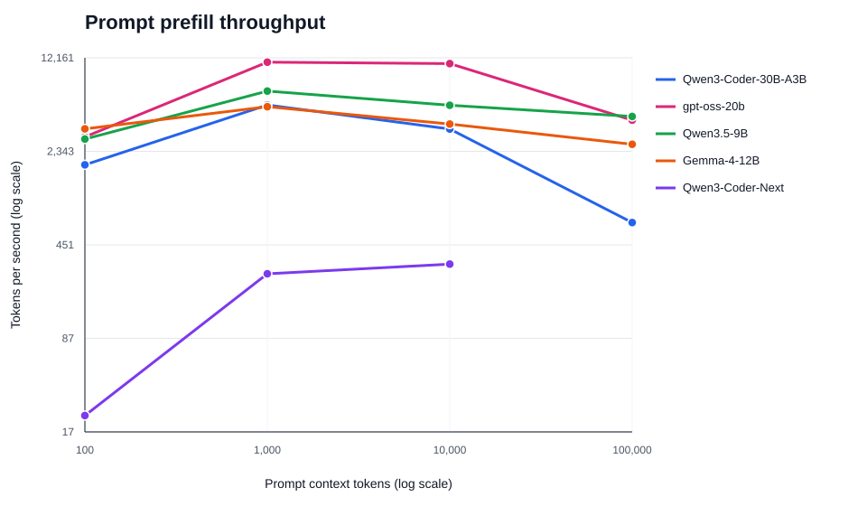
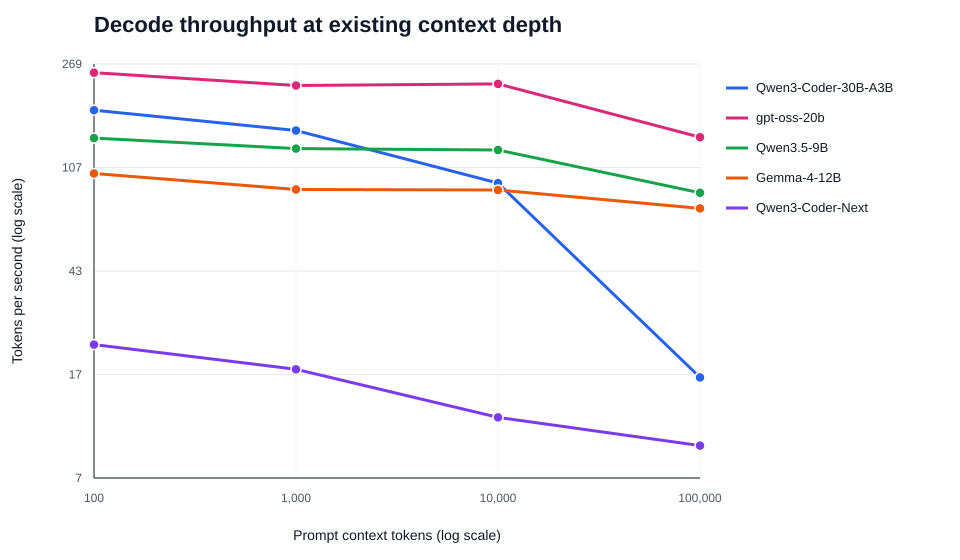

# Local LLM context benchmark

## Hardware and measurement setup

RTX 5080 (16 GiB VRAM), Ryzen 9 9950X3D exposed as 8 CPUs in WSL, 50 GiB system memory, llama.cpp CUDA build. Single sequence, 8 threads, Flash Attention on, F16 KV cache, llama.cpp automatic GPU fit with a 1 GiB VRAM margin. Each result uses llama.cpp's normal warm-up; contexts through 10k have 3 measured repetitions, 100k has 1 because a full prompt is also processed for warm-up.

These are throughput measurements, not coding-quality or task-completion scores. Prefill uses synthetic token IDs and starts from an empty KV cache. Decode first fills the KV cache to the listed depth, then measures 64 generated tokens. Tokenization, sampling, agent tools, and disk/repo parsing are excluded. The 500k cases are marked unsupported because every installed GGUF advertises a native context limit below 500k; no extrapolated runs were used.

## Model placement

For placement, `CUDA model buffer` is compared with GGUF file size at 100k context. This captures context-driven auto-fit: a larger KV cache can force weight tensors into host RAM even when all layers are listed as GPU-offloaded. `RAM offload` means the CUDA model buffer is below 70% of the GGUF size; the other rows are GPU-resident with small host buffers. `CPU mapped` is llama.cpp's host model buffer, which can also include mapped source tensors.

| Model | Quant measured | Native context | CUDA model buffer at 100k / GGUF size | CPU mapped at 100k | Placement at 100k |
|---|---:|---:|---:|---:|---|
| Qwen3-Coder-30B-A3B | Q3_K_M | 262,144 | 4,234 / 14,030 MiB | 13,781 MiB | RAM offload |
| gpt-oss-20b | Q4_K_M | 131,072 | 10,694 / 11,086 MiB | 380 MiB | GPU-resident; small host buffers |
| Qwen3.5-9B | Q4_K_M | 262,144 | 4,861 / 5,417 MiB | 546 MiB | GPU-resident; small host buffers |
| Gemma-4-12B | Q4_K_M | 262,144 | 6,777 / 6,792 MiB | 540 MiB | GPU-resident; small host buffers |
| Qwen3-Coder-Next | Q4_K_M | 262,144 | 10,743 / 46,280 MiB | 46,031 MiB | RAM offload |

## Throughput by context

### Prefill

Tokens per second while ingesting a prompt of the listed size. Both chart axes use logarithmic scaling:

| Model | Context | Prefill tok/s (SD where repeated) |
|---|---:|---:|
| Qwen3-Coder-30B-A3B | 100 | 1,847.6 (SD 177.0) |
| Qwen3-Coder-30B-A3B | 1,000 | 5,303.4 (SD 97.7) |
| Qwen3-Coder-30B-A3B | 10,000 | 3,470.7 (SD 66.4) |
| Qwen3-Coder-30B-A3B | 100,000 | 668.7 |
| Qwen3-Coder-30B-A3B | 500,000 | unsupported (native limit) |
| gpt-oss-20b | 100 | 3,020.2 (SD 19.7) |
| gpt-oss-20b | 1,000 | 11,260.2 (SD 175.6) |
| gpt-oss-20b | 10,000 | 10,984.7 (SD 333.4) |
| gpt-oss-20b | 100,000 | 4,053.4 |
| gpt-oss-20b | 500,000 | unsupported (native limit) |
| Qwen3.5-9B | 100 | 2,908.1 (SD 440.8) |
| Qwen3.5-9B | 1,000 | 6,773.0 (SD 108.4) |
| Qwen3.5-9B | 10,000 | 5,276.9 (SD 2,070.8) |
| Qwen3.5-9B | 100,000 | 4,331.5 |
| Qwen3.5-9B | 500,000 | unsupported (native limit) |
| Gemma-4-12B | 100 | 3,484.3 (SD 653.5) |
| Gemma-4-12B | 1,000 | 5,143.1 (SD 49.0) |
| Gemma-4-12B | 10,000 | 3,785.5 (SD 1,249.2) |
| Gemma-4-12B | 100,000 | 2,652.9 |
| Gemma-4-12B | 500,000 | unsupported (native limit) |
| Qwen3-Coder-Next | 100 | 22.3 (SD 22.6) |
| Qwen3-Coder-Next | 1,000 | 271.3 (SD 53.0) |
| Qwen3-Coder-Next | 10,000 | 321.5 (SD 2.9) |
| Qwen3-Coder-Next | 100,000 | timeout (>10 min) |
| Qwen3-Coder-Next | 500,000 | unsupported (native limit) |

### Decode

Tokens per second after the KV cache is already filled to the listed context depth. Both chart axes use logarithmic scaling:

| Model | Context | Decode tok/s (SD where repeated) |
|---|---:|---:|
| Qwen3-Coder-30B-A3B | 100 | 178.6 (SD 15.2) |
| Qwen3-Coder-30B-A3B | 1,000 | 149.1 (SD 8.1) |
| Qwen3-Coder-30B-A3B | 10,000 | 93.5 (SD 27.1) |
| Qwen3-Coder-30B-A3B | 100,000 | 16.6 |
| Qwen3-Coder-30B-A3B | 500,000 | unsupported (native limit) |
| gpt-oss-20b | 100 | 249.3 (SD 2.6) |
| gpt-oss-20b | 1,000 | 222.5 (SD 20.5) |
| gpt-oss-20b | 10,000 | 225.7 (SD 8.7) |
| gpt-oss-20b | 100,000 | 140.5 |
| gpt-oss-20b | 500,000 | unsupported (native limit) |
| Qwen3.5-9B | 100 | 139.3 (SD 5.3) |
| Qwen3.5-9B | 1,000 | 127.0 (SD 3.6) |
| Qwen3.5-9B | 10,000 | 125.4 (SD 3.6) |
| Qwen3.5-9B | 100,000 | 85.7 |
| Qwen3.5-9B | 500,000 | unsupported (native limit) |
| Gemma-4-12B | 100 | 101.7 (SD 3.5) |
| Gemma-4-12B | 1,000 | 88.3 (SD 2.5) |
| Gemma-4-12B | 10,000 | 87.9 (SD 6.3) |
| Gemma-4-12B | 100,000 | 74.6 |
| Gemma-4-12B | 500,000 | unsupported (native limit) |
| Qwen3-Coder-Next | 100 | 22.2 (SD 2.4) |
| Qwen3-Coder-Next | 1,000 | 17.9 (SD 8.3) |
| Qwen3-Coder-Next | 10,000 | 11.6 (SD 4.0) |
| Qwen3-Coder-Next | 100,000 | 9.1 |
| Qwen3-Coder-Next | 500,000 | unsupported (native limit) |

## Not installed

The catalog has additional models that are not downloaded, so they could not be benchmarked without fetching their GGUFs:

- Qwen3.8-27B (`qwen3.8-27b`)
- DeepSeek-R1-Distill-Qwen-14B (`r1-distill-qwen-14b`)
- DeepSeek-R1-Distill-Qwen-32B (`r1-distill-qwen-32b`)
- gpt-oss-120b (`gpt-oss-120b`)
- Qwen3.5-122B-A10B (`qwen3.5-122b-a10b`)
- GLM-5.3-Flash (`glm-5.3-flash`)
- DeepSeek-V4.1-Flash (`deepseek-v4-flash`)
- DeepSeek-R1-Distill-Llama-70B (`r1-distill-llama-70b`)

Raw measurements and individual command/error details are in [`measurements.csv`](measurements.csv) and [`measurements.json`](measurements.json).
